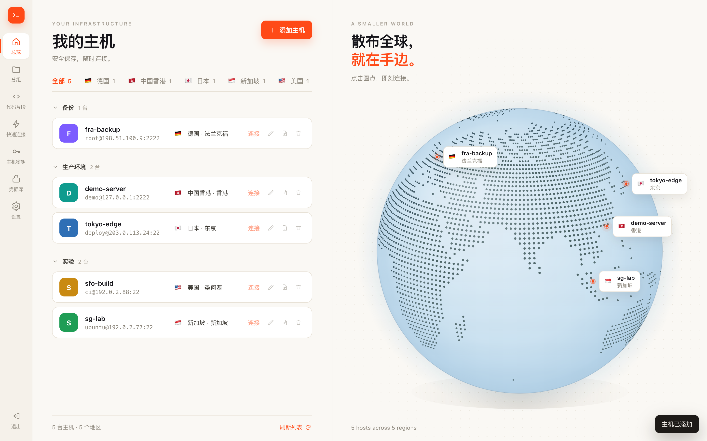
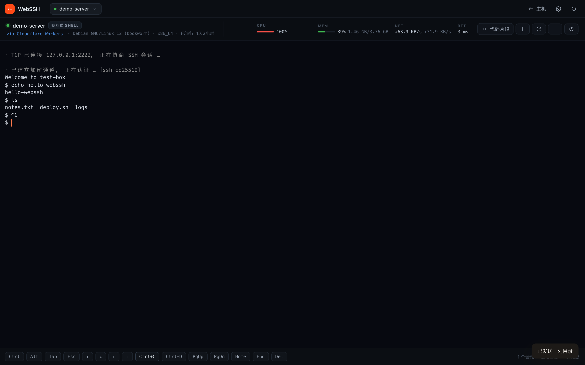

# WebSSH

在浏览器里使用的 SSH 客户端。整个应用跑在 Cloudflare Workers 上：一个 Worker + 一个 R2 存储桶，**不需要服务器**。

- 首次打开让你设置管理员账号密码，之后用它登录
- 浅色仪表盘：主机分组、地区筛选、点阵地球（每台主机一个可点的城市标签）
- 深色终端页：多标签、实时监控（CPU / 内存 / 网络 / RTT / 负载）、底部特殊按键条、代码片段一键发送
- 主机列表（密码 / 私钥两种认证），凭据 AES-GCM 加密后存在你自己的 R2 里
- 主机密钥 TOFU 校验：首次连接弹指纹确认，之后指纹变化直接拒绝（防中间人）
- 可选的会话录制，保存在 R2 里随时回看

> SSH 协议栈是自己实现的（`src/ssh/`），只依赖 WebCrypto：`curve25519-sha256` 密钥交换、`aes{128,192,256}-ctr` 加密、`hmac-sha2-{256,512}` / `hmac-sha1` 校验、`ssh-ed25519` / `ecdsa-sha2-nistp256` / `rsa-sha2-{256,512}` / `ssh-rsa` 主机密钥，支持密码、公钥（OpenSSH / PKCS#1 / PKCS#8）、keyboard-interactive 认证。

---

## 部署（Cloudflare 控制台 + GitHub，R2 自动创建）

1. **先开通 R2**：Cloudflare 控制台 → R2 → 点一次同意条款。没开通的话，自动创建存储桶会失败，这是最常见的部署失败原因。
2. 把这个仓库推到 GitHub（public / private 都行）。
3. 控制台 → **Workers & Pages → Create → Workers → Connect to Git**，选中仓库。
4. 构建设置填：

   | 配置项 | 值 |
   | --- | --- |
   | Project name | `webssh`（**必须和 `wrangler.jsonc` 里的 `name` 完全一致**） |
   | Build command | `npm install` |
   | Deploy command | `npx wrangler deploy` |

5. 点部署。`wrangler.jsonc` 里的 R2 绑定故意没写 `bucket_name`：

   ```jsonc
   "r2_buckets": [{ "binding": "BUCKET" }]
   ```

   所以首次部署时 Cloudflare 会**自动创建**一个以 Worker 名开头的存储桶并完成绑定，不用手工建桶、不用填 ID。

6. 打开 `https://<worker>.<subdomain>.workers.dev`，第一次访问会让你设置管理员账号密码。

> ⚠️ 两个坑，先看一眼：
> - 通过 Dashboard（GitHub）部署时，资源会被自动创建，但**创建出来的 bucket 名称不会写回仓库**。以后如果想改用本地 `wrangler deploy`，要先去控制台把 bucket 名字填进 `wrangler.jsonc` 的 `bucket_name`，否则 wrangler 会认为没有绑定、再建一套新的（看起来就像"数据丢了"）。
> - 修改 `wrangler.jsonc` 里的 `name` 等于换一个应用：会自动创建另一套 R2，原来的数据不会跟过来。

### 本地开发

```bash
npm install
npx wrangler dev        # http://127.0.0.1:8787，本地 R2 存在 .wrangler/ 下
npx wrangler deploy     # 或者用 CLI 部署（需要先 wrangler login）
```

本地 `wrangler dev` 时 R2 是本地模拟的，删掉 `.wrangler/state` 就等于清空所有数据（包括管理员账号）。

### 测试

```bash
npm test                # 端到端：起一个本地 sshd + wrangler dev + 真 Chrome 走完整流程
node tests/e2e.mjs --headful   # 想看着它点的话
```

`tests/e2e.mjs` 覆盖：初始化 → 添加主机 → 分组/筛选 → 主机密钥确认 → 终端交互 → 监控指标 → 代码片段 → 特殊按键 → 多标签 → 刷新保持登录 → 退出登录。依赖 `ssh2`（本地 SSH 服务端）与 `playwright-core`（用你机器上的 Chrome，不额外下载浏览器）。

---

## 用起来

- **添加主机**：名称、分组、主机、端口、用户名，选密码或私钥，再选地区和城市。地区和城市决定它在筛选标签和地球上的位置。
- **连接**：点主机行或「连接」。凭据保存在 R2 的话一键直连；没保存则弹窗临时输入（只在内存里用）。
- **快速连接**：左侧 ⚡，临时连接不落库，可以顺手勾选「同时保存到我的主机」。
- **代码片段**：左侧「代码片段」里维护常用命令；终端页右上角也能打开，点一下直接发送到当前会话。
- **监控**：连上 Linux 主机后，顶部信息条每 3 秒刷新一次 CPU / 内存 / 网络 / RTT，数据来自 `/proc`（一次 `exec` 通道采样，不打断你的 shell）。非 Linux 会显示「不可用」。
- **特殊按键**：底部按键条有 Ctrl / Alt 修饰键、Tab / Esc、方向键、Ctrl+C / Ctrl+D、PgUp / PgDn / Home / End / Del，手机上没有实体键盘时很好用。
- **主机密钥**：首次连接会弹指纹确认（`SHA256:...`，和 `ssh-keygen -lf` 输出一致）。服务器重装后指纹会变，需要先在「主机密钥」里删掉旧记录再连。
- **会话日志**：设置里可以默认开启录制。开启后终端输出会以文本形式存到 R2，在「会话日志」里查看 / 复制 / 删除。
- **快捷键**：`Ctrl/Cmd+Shift+C` 复制选中、`Ctrl/Cmd+Shift+V` 粘贴、`Ctrl/Cmd+Shift+F` 全屏、`Ctrl/Cmd+Shift+R` 重连、`Alt+1..9` 切换标签、`Ctrl/Cmd+Shift+W` 关闭当前标签；终端里右键 = 粘贴。

---

## 它是怎么实现的

```
浏览器 (xterm.js)  ──WebSocket──▶  Worker  ──TCP(cloudflare:sockets)──▶  sshd:22
                                     │
                                     ├── 同一条 SSH 连接：shell 通道 + exec 通道（采样 /proc）
                                     └── R2：账号 / 会话 / 主机 / 已知主机密钥 / 录制 / 片段
```

| 文件 | 作用 |
| --- | --- |
| `src/worker.js` | 路由：页面、`/api/*`、`/ws` 升级；在 fetch 处理器内建立 TCP 连接 |
| `src/session.js` | WebSocket ↔ SSH 桥接：状态推送、主机密钥确认、窗口调整、录制、保活、监控采样 |
| `src/ssh/client.js` | SSH-2 传输层 / 密钥交换 / 认证 / 多通道（shell + exec） |
| `src/ssh/crypto.js` | CTR 密钥流（按包偏移连续）、HMAC、密钥派生、主机密钥签名校验 |
| `src/ssh/keys.js` | OpenSSH / PKCS#1 / PKCS#8 私钥解析与签名 |
| `src/auth.js` | PBKDF2 口令、会话 Cookie、登录限流、凭据加解密 |
| `src/store.js` | R2 读写封装 |
| `src/pages.js` | 单页骨架（所有数据都走 `/api/*`，HTML 里没有任何秘密） |
| `public/js/app.js` | 前端主控：登录、主机增删改、分组筛选、弹窗、设置 |
| `public/js/globe.js` | 点阵地球：正交投影 + 拖拽旋转 + 标签跟随 |
| `public/js/land.js` | 2°×2° 陆地掩码（构建期从 geo 数据光栅化生成，运行时零依赖） |
| `public/js/term.js` | 终端页：多标签、WebSocket 会话、监控面板、按键条 |
| `public/vendor/` | xterm.js（随仓库内置，不依赖 CDN） |

R2 里的数据布局：

```
sys/admin           管理员账号（PBKDF2-SHA256 + 随机盐）
sys/master          凭据加密用的主密钥
sys/snippets        代码片段
sess/<token>        登录会话（30 天）
hosts/<id>          主机配置（密码/私钥字段为 AES-GCM 密文）
known/<host>_<port> 已信任的主机密钥指纹
logs/<id>.log       会话录制（纯文本 + 元数据）
throttle/<ip>       登录失败计数
```

---

## 安全说明（请读完）

- **单管理员模型**：第一个完成初始化的账号就是唯一账号，没有注册入口。忘了密码只能清掉 R2 里的 `sys/admin` 和 `sess/*` 重新初始化（会失去已保存的凭据）。
- **凭据加密的边界**：密码和私钥用 AES-GCM 加密后存 R2，主密钥默认也放在同一个桶的 `sys/master` 里。这能防"桶被人翻到"，但**不能防"Cloudflare 账号被攻破"**——毕竟你的 Worker 代码本身也能读到它。想更硬一点，可以自己设一个 Secret：

  ```bash
  npx wrangler secret put WEBSSH_MASTER_KEY   # 32 字节 base64，或 64 位 hex
  ```

  设置后就不会再用 `sys/master`，但**换了主密钥，之前保存的凭据都解不开**（需要重新录入）。
- **会话记录是明文**：录下来的是终端原始输出，可能包含你敲过的命令、打印出来的密钥。不放心就别开。
- **登录限流**：同一 IP 10 分钟内失败 6 次，锁 15 分钟。
- **CSRF**：写接口只接受 `application/json`，并校验 `HttpOnly` + `SameSite=Lax` 的会话 Cookie。
- **出口限制**：Workers 只能连公网地址（Cloudflare 自家 IP 段、localhost、内网地址都会被拒绝）。所以这个工具**连不了内网机器**，除非那台机器有公网入口。





## 已知限制

- 免费计划每个请求的 CPU 时间有限（10ms），长时间大流量输出（比如 `yes`、`cat` 大文件）可能被中断；日常运维够用，重度使用建议上 Paid 计划（$5/月，30s CPU）。
- 监控面板依赖 Linux 的 `/proc`，BSD / macOS / Windows 主机上会显示「不可用」（终端本身照常可用）。
- 暂不支持：SFTP 传文件、端口转发、Agent 转发、带口令的 OpenSSH 私钥（`bcrypt_pbkdf`）。带口令的私钥请先用 `ssh-keygen -p -m PEM` 转成无口令 PEM。
- 只支持 `curve25519-sha256` 系列密钥交换和 CTR 系列加密算法。非常老的服务器（只支持 `diffie-hellman-group1-sha1` / `3des-cbc`）连不上。

## 许可

MIT
